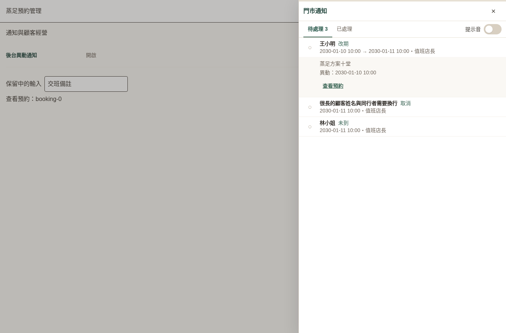
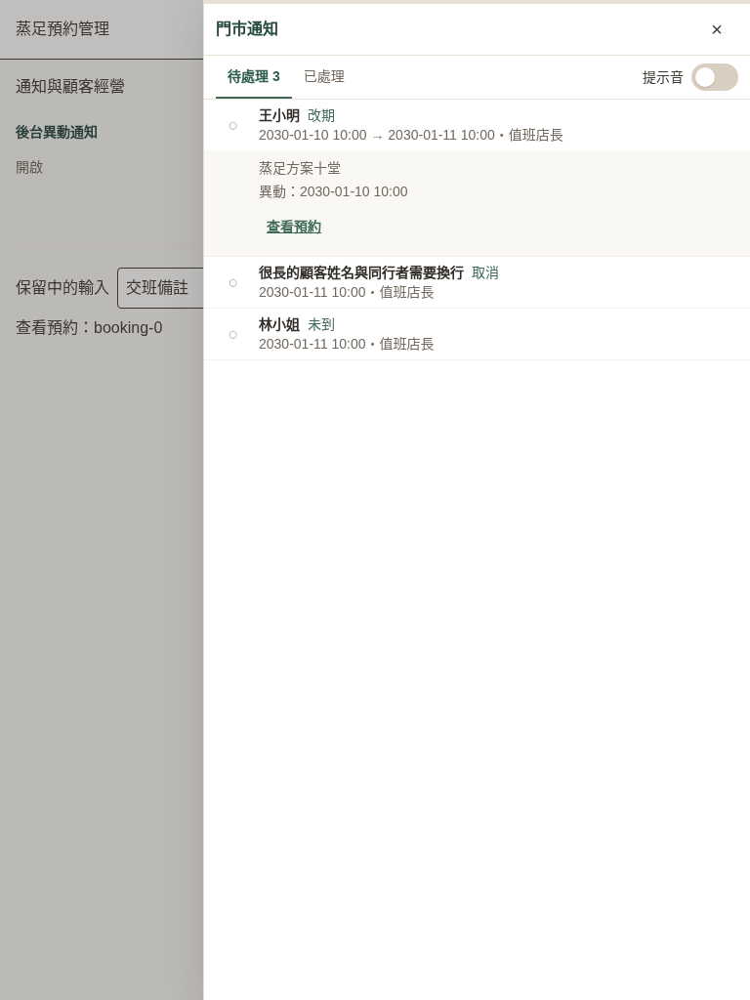

# 蒸足後台異動通知驗證

新增入口：蒸足後台頂欄鈴鐺；設定 → 通知與顧客經營 → 後台異動通知。既有及新增店家預設開啟。

- 預約新建、完成服務屬資訊紀錄；取消、改期、內容修改、未到、恢復為待處理。
- Booking 資料庫觸發器涵蓋後台、會員、LIFF 與公開體驗的交易；異動與通知一起提交或回滾。只記錄啟用後的新操作，不掃描舊預約。
- 每筆預約維持一筆通知；新異動恢復待處理，連續改期保留第一次原時間。處理狀態有門市條件、修訂檢查與操作稽核。
- 共用門市通知呈現、裝置提示音、失敗還原、分頁、返回原工作頁及草稿保留；蒸足查看預約沿用既有 BookingDetailDrawer。
- 新增私有表與 SECURITY INVOKER 觸發器；RLS 開啟、不授權瀏覽器角色直接存取。課程資料與業務規則獨立保留。

## 已驗證

- PGlite 執行完整 migration 與真實觸發器：預設值、無設定店家、時間轉換、事件分類、連續改期、處理後重新待處理、相同操作重試、交易回滾、停用／重新啟用、跨店快照隔離、修訂及 RLS。
- Server action 測試：權限、唯讀與目前門市／模組核對、分頁與序列化、停用、舊修訂拒絕、設定衝突與稽核。
- 元件測試：蒸足開啟既有預約明細與唯讀參數、設定即時儲存與失敗還原；課程通知的既有元件測試保持通過。
- Chromium 合成預覽：1366×900、1920×1080、1024×768、768×1024、560×800、390×844。無整頁水平溢出，標記、復原、失敗還原、查看預約 callback、保留草稿、開關通知皆通過；結果見 results.json。
- 型別檢查與變更檔案 ESLint 通過。

## 驗收限制

合成預覽使用 stub actions，未連正式或測試資料庫，亦非 iPad 真機驗收。預約明細在元件測試中檢查入口、ID 與唯讀參數；預覽不冒充登入後完整預約／付款流程驗收。資料庫觸發器測試使用隔離 PGlite。

本機完整 Vitest 在 sandbox 中有 spawnSync EPERM 的環境阻擋；不得把它宣稱為全部通過。雲端 CI 結果應另以 PR checks 為準。正式資料庫 migration 與功能上線尚未在本次預覽執行。

