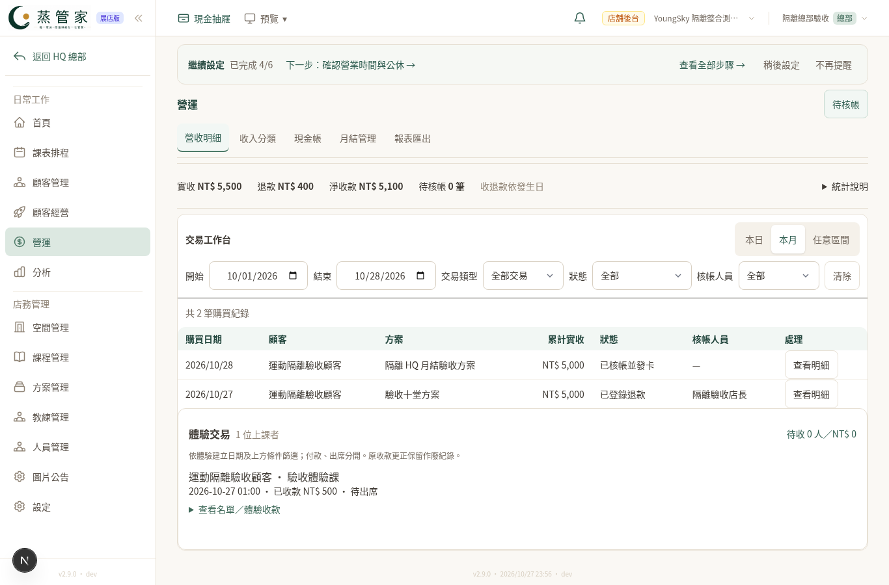
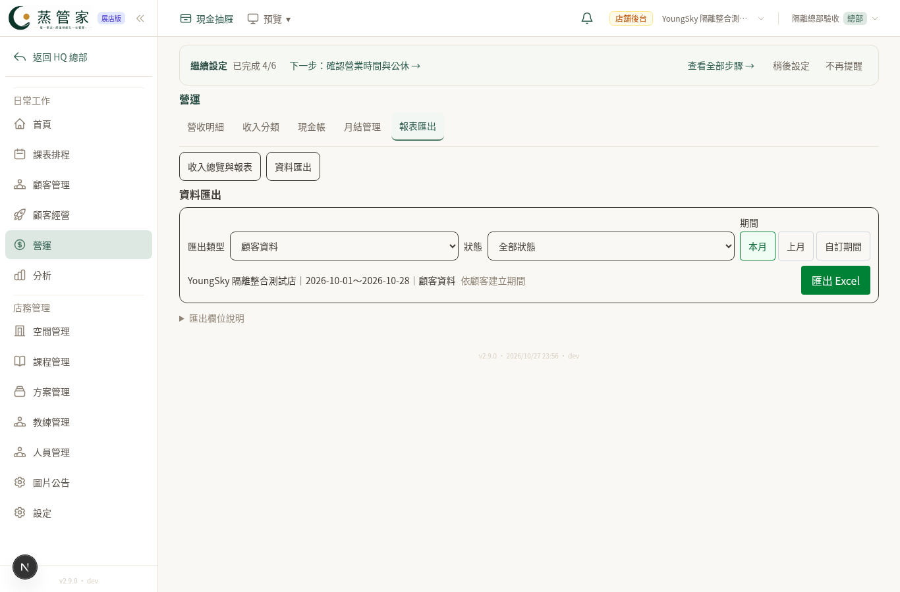
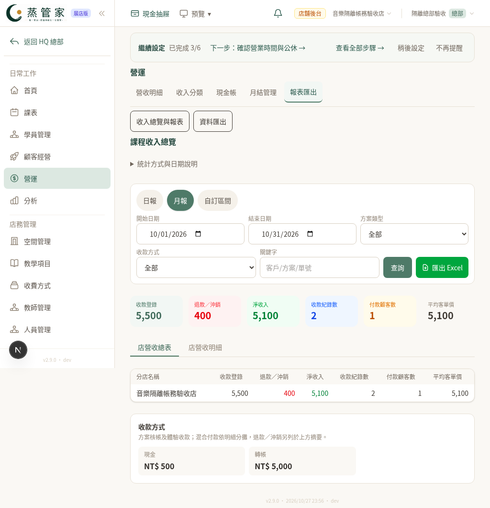
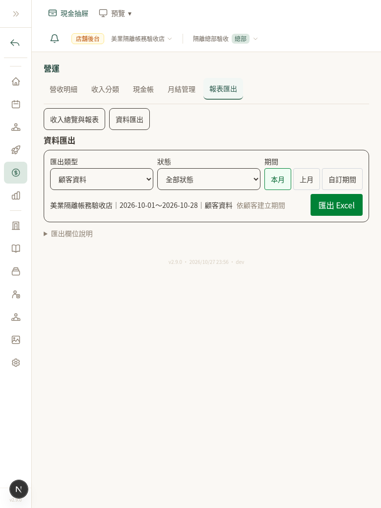

# 營運密度與 HQ 月結驗收（2026-10-28）

## 調整內容

- 營收明細、報表與資料匯出共用依容器寬度排列的工具列；寬版日期標籤與欄位同行，窄版換列，保留字級及 44px 輸入／主要操作區。移除重複筆數及教學文字，欄位說明收合。
- 課程月結的 HQ 角色資格不再依賴新版音樂開關。頁面、人員管理的月結入口、確認、設定、付款／更正與通知人員均使用同一角色規則。保留具體門市、功能開通、訂閱、各操作權限與帳務交易檢查。
- HQ 表單綁定開啟時的門市，切店後的舊確認、付款、更正、設定與通知請求會受阻。確認與付款表單顯示操作門市。美業沿用原本的門市檢查並共用門市顯示。
- 月結確認與付款登錄分開呈現。未付與溢付逐筆加總，不互相抵銷；確認仍不產生付款。蒸足保留自己的服務收入／租金內容。
- 頁籤保存各自適用的篩選，分開現金帳／交易清單的同名條件；清除條件後不復活舊篩選。快速改日期後切頁，以點擊當下的 URL 為準。
- 匯出前一行顯示門市、期間、類型、狀態及日期口徑；無門市時不猜第一家店。匯出錯誤就地顯示。

## 已完成的實際操作

使用本機隔離 PostgreSQL、實際 Next 路由、假 HQ／店長帳號；不讀寫正式站。

- 五模組店長登入及 25 個營運頁籤：30 項通過。
- HQ 具體門市限制、運動／音樂／舞蹈月結確認與授課費付款、與現金帳連動；三店的切店舊付款請求皆受阻。
- 五模組的營收、報表、匯出於 1366×900、1024×768、768×1024：45 個畫面通過；無整頁水平溢出，顯示中的輸入／選擇欄位至少 44px。
- 快速修改匯出期間後往返營收、恢復類型與篩選：通過。
- 五模組實際下載 Excel、驗證請求類型及活頁簿可讀：通過。
- 最終瀏覽器流程 64 項通過，零瀏覽器錯誤。詳見 [browser.json](browser.json)。
- HQ 通知預覽與切店阻擋以 mock transport 回歸測試，沒有對外發 LINE。

## 代表畫面

| 營收桌機 | 匯出桌機 |
| --- | --- |
|  |  |

| 音樂報表 iPad 橫向 | 美業匯出 iPad 直向 |
| --- | --- |
|  |  |

另附 [營收直向](ledger-ipad-portrait.png)、[蒸足橫向](steam-ledger-ipad.png)。

## 範圍與限制

這是本機實際業務預覽與 Chromium 視窗尺寸驗收；不是實體 iPad 測試，也未在正式站登錄財務資料、改資料庫結構或發送通知。此分支關閉自動部署，尚未合併或上線。全站回歸的精確結果另列於 PR 檢查紀錄。
